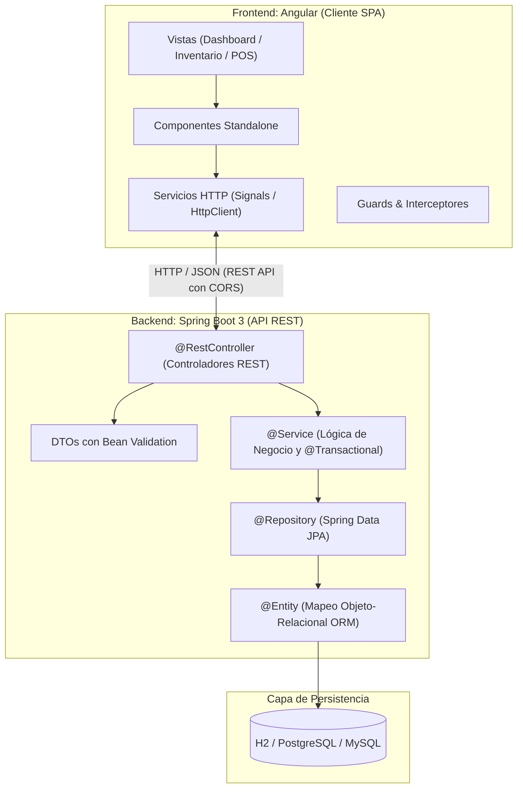
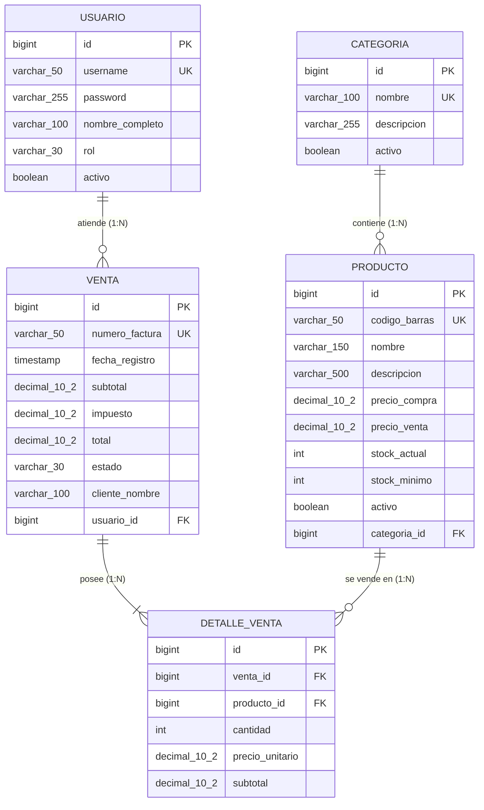

# 📋 Especificación Técnica y Arquitectura del Sistema
## Sistema de Gestión de Inventario y Punto de Venta (POS)

> **Documento de Diseño de Software (SDD)** para el proyecto Fullstack desarrollado con **Java 21 / Spring Boot 3** y **Angular 19+**.

---

## 1. Visión General del Proyecto

### 1.1 Objetivo
Desarrollar una solución integral para pequeñas y medianas empresas comerciales que permita:
- Administrar el catálogo de productos por categorías.
- Controlar existencias (stock) en tiempo real con alertas de stock crítico.
- Registrar ventas con cálculo automático de totales e impuestos.
- Garantizar la consistencia transaccional (descuento automático de inventario con rollback ante fallos).
- Generar comprobantes/facturas descargables en formato PDF.

### 1.2 Stack Tecnológico
* **Backend:** Java 21 LTS, Spring Boot 3.x, Spring Data JPA, Hibernate, Maven, Lombok, Spring Validation.
* **Base de Datos:** H2 Database (desarrollo/pruebas) migable a PostgreSQL/MySQL (producción).
* **Frontend:** Angular 19+ (Standalone Components, Signals, Reactive Forms, Tailwind CSS).
* **Seguridad (Fase Avanzada):** Spring Security 6 + JWT (JSON Web Tokens).

---

## 2. Arquitectura General del Sistema



---

## 3. Modelo de Base de Datos (Relacional)

### 3.1 Diagrama Entidad-Relación (ERD)



### 3.2 Reglas de Negocio en Base de Datos:
1. `codigo_barras` debe ser único en la tabla `PRODUCTO`.
2. `stock_actual` nunca puede ser inferior a 0 (validado a nivel de servicio y restricción `CHECK`).
3. Si un producto alcanza `stock_actual <= stock_minimo`, se genera bandera de reabastecimiento.
4. El descuento de stock durante la venta se ejecuta de manera atómica bajo una transacción `@Transactional`. Si un solo item no tiene stock disponible, se cancela toda la venta.

---

## 4. Diseño del Backend (Spring Boot 3)

### 4.1 Estructura de Paquetes (Arquitectura Limpia en Capas)
```text
inventory-backend/
├── src/main/java/com/inventario/
│   ├── config/             # Configuración de CORS, OpenAPI/Swagger, etc.
│   ├── controller/         # Endpoints REST (@RestController)
│   ├── dto/                # Data Transfer Objects (Request/Response)
│   ├── entity/             # Entidades JPA (@Entity)
│   ├── exception/          # Manejo global de excepciones (@ControllerAdvice)
│   ├── mapper/             # Conversores Entity <-> DTO (MapStruct o manual)
│   ├── repository/         # Interfaces de acceso a datos (JpaRepository)
│   └── service/            # Interfaces e implementación de la lógica de negocio
│       └── impl/
└── src/main/resources/
    ├── application.properties
    └── data.sql            # Datos iniciales de prueba (categorías y productos)
```

### 4.2 Contrato de Endpoints REST (API Specification)

#### **Módulo Productos (`/api/v1/productos`)**
| Método | Endpoint | Descripción | Status Exitoso | Errores Posibles |
| :--- | :--- | :--- | :--- | :--- |
| `GET` | `/api/v1/productos` | Listar productos paginados y filtrables | `200 OK` | `500` |
| `GET` | `/api/v1/productos/{id}` | Obtener producto por ID | `200 OK` | `404 Not Found` |
| `GET` | `/api/v1/productos/codigo/{codigo}` | Buscar producto por código de barras | `200 OK` | `404 Not Found` |
| `POST` | `/api/v1/productos` | Crear un nuevo producto con validaciones | `201 Created` | `400 Bad Request`, `409 Conflict` |
| `PUT` | `/api/v1/productos/{id}` | Actualizar datos del producto | `200 OK` | `400`, `404` |
| `DELETE` | `/api/v1/productos/{id}` | Eliminación lógica (desactivar) | `204 No Content` | `404` |
| `GET` | `/api/v1/productos/stock-bajo` | Lista de productos con stock crítico | `200 OK` | `500` |

#### **Módulo Ventas (`/api/v1/ventas`)**
| Método | Endpoint | Descripción | Status Exitoso | Errores Posibles |
| :--- | :--- | :--- | :--- | :--- |
| `POST` | `/api/v1/ventas` | Registrar una nueva venta (descuenta stock) | `201 Created` | `400 (Stock insuficiente)` |
| `GET` | `/api/v1/ventas` | Historial de ventas con fechas y totales | `200 OK` | `500` |
| `GET` | `/api/v1/ventas/{id}` | Detalle completo de una venta | `200 OK` | `404 Not Found` |
| `GET` | `/api/v1/ventas/{id}/pdf` | Descargar factura generada en PDF | `200 OK (application/pdf)` | `404` |

---

## 5. Diseño del Frontend (Angular 19+)

### 5.1 Estructura Modular por Características (Feature-Driven)
```text
inventory-frontend/
├── src/
│   ├── app/
│   │   ├── core/                  # Singleton: servicios globales, interceptores
│   │   │   ├── interceptors/      # ErrorInterceptor, AuthInterceptor
│   │   │   └── services/          # Notificaciones, Storage
│   │   ├── features/              # Módulos de funcionalidad de la app
│   │   │   ├── dashboard/         # Vista principal con métricas y gráficos
│   │   │   ├── products/          # Lista, formulario y detalle de productos
│   │   │   │   ├── components/    # Tabla, tarjetas de producto
│   │   │   │   ├── pages/         # ProductListPage, ProductDetailPage
│   │   │   │   ├── models/        # Product.ts, Category.ts
│   │   │   │   └── services/      # ProductService.ts
│   │   │   ├── sales/             # Punto de Venta (POS) y carrito
│   │   │   │   ├── components/    # Carrito de compra, buscador rápido
│   │   │   │   └── pages/         # PosPage, SalesHistoryPage
│   │   ├── shared/                # Componentes reutilizables en toda la app
│   │   │   ├── components/        # Navbar, Sidebar, Modal, ConfirmDialog
│   │   │   └── pipes/             # CurrencyFormatter, StockBadgePipe
│   │   ├── app.routes.ts          # Configuración de rutas
│   │   └── app.config.ts          # Proveedores globales (provideHttpClient)
│   ├── assets/                    # Imágenes y logos
│   └── styles.css                 # Estilos globales y utilidades Tailwind
```

### 5.2 Rutas Principales del Frontend
* `/` $\rightarrow$ Redirige a `/dashboard`
* `/dashboard` $\rightarrow$ Resumen: ventas del día, total de productos y alertas de stock bajo.
* `/productos` $\rightarrow$ Tabla interactiva de inventario con filtros, paginación y búsqueda.
* `/productos/nuevo` $\rightarrow$ Formulario reactivo para registrar producto.
* `/ventas/pos` $\rightarrow$ Pantalla de caja registradora / cobro ágil.
* `/ventas/historial` $\rightarrow$ Reporte histórico y descarga de facturas en PDF.

---

## 6. Plan de Implementación por Fases (Roadmap)

### 📌 Fase 1: El Walking Skeleton (Pilar Base)
* [ ] Configurar `application.properties` (H2 DB, JPA, Puerto 8080).
* [ ] Configurar CORS en Spring Boot para permitir llamadas desde `http://localhost:4200`.
* [ ] Crear entidad `Categoria` y `Producto` con JPA.
* [ ] Crear `ProductoRepository`, `ProductoService` y `ProductoController`.
* [ ] Crear servicio y componente en Angular para listar productos recibidos de la API.

### 📌 Fase 2: Gestión de Catálogo y Formularios
* [ ] Implementar creación, edición y eliminación de productos (CRUD completo).
* [ ] Validaciones en backend (Bean Validation `@NotNull`, `@Min`, `@NotBlank`) y en Angular (`ReactiveFormsModule`).
* [ ] Notificaciones en pantalla con mensajes Toast (éxito/error).

### 📌 Fase 3: Punto de Venta (POS) y Transacciones
* [ ] Modelo y endpoints para `Venta` y `DetalleVenta`.
* [ ] Lógica de descuento de stock transaccional con `@Transactional`.
* [ ] Interfaz de POS en Angular: carrito dinámico, cálculo de cambio y confirmación.

### 📌 Fase 4: Reportes, Filtros y PDF
* [ ] Generación de factura en PDF en el backend con iText/OpenPDF.
* [ ] Descarga y visualización del PDF desde Angular.
* [ ] Dashboard con tarjetas resumen (Signals y Chart.js).

### 📌 Fase 5: Seguridad y Despliegue (Preparación para Portafolio)
* [ ] Spring Security con JWT para autenticación.
* [ ] Roles: `ADMIN` y `CAJERO`.
* [ ] Dockerización (Dockerfile para backend y frontend).
